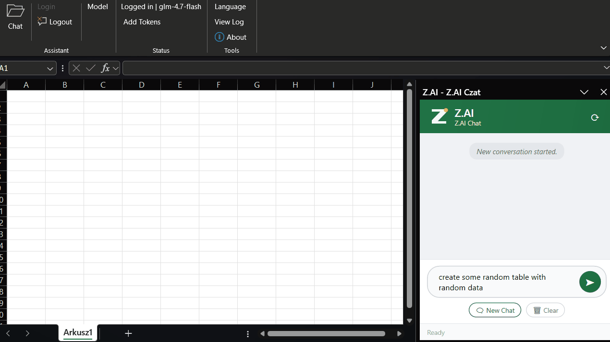

# Z.AI Excel Add-in

[](LICENSE)
[](https://dotnet.microsoft.com/)
[](https://www.microsoft.com/windows)
[](https://www.microsoft.com/excel)
[](https://github.com/cino893/z.ai-Unofficial-Excel-Com-Add-in-addon/releases/latest)
[](https://github.com/cino893/z.ai-Unofficial-Excel-Com-Add-in-addon/issues)

[🇵🇱 Czytaj po polsku](README.pl.md)

**A free, open-source Excel add-in powered by Z.AI (Zhipu AI)** — Chat with an AI assistant that can read, write, format, chart, and automate your spreadsheets. Perfect for data analysis, report automation, and Excel productivity.

> ⚠️ **Disclaimer:** This is an unofficial, community-developed add-in. It is not affiliated with, endorsed by, or in any way officially connected to Zhipu AI / Z.AI.



## Download

- **[⬇ Download latest .xll](https://github.com/cino893/z.ai-Unofficial-Excel-Com-Add-in-addon/releases/latest/download/ZaiExcelAddin-AddIn64-packed.xll)**
- [All releases](https://github.com/cino893/z.ai-Unofficial-Excel-Com-Add-in-addon/releases)

GitHub Releases attach the packed 64-bit (and 32-bit, when produced) `.xll` files via Actions (`release.yml`). Current product version is **5.0.0**.

## Installation

1. Download the `.xll` file above
2. Open Excel → **File** → **Options** → **Add-ins**
3. At the bottom: **Manage** → **Excel Add-ins** → **Go…**
4. Click **Browse** and select the downloaded `ZaiExcelAddin-AddIn64-packed.xll`
5. Confirm — the **Z.AI** tab appears on the ribbon

> 📖 Need a visual guide? See [How to add an Excel Add-in — with screenshots (Microsoft Support)](https://support.microsoft.com/en-us/office/add-or-remove-add-ins-in-excel-0af570c4-5cf3-4fa9-9b88-403625a0b460). Note: this Microsoft Support page is the "Add or remove add-ins in Excel" topic (Polish: "Dodawanie lub usuwanie dodatku COM").

### Requirements

- Microsoft Excel 2016+ (Windows, 64-bit recommended)
- [.NET 8.0 Desktop Runtime](https://dotnet.microsoft.com/download/dotnet/8.0)
- Z.AI API key — [get one here](https://z.ai/manage-apikey/apikey-list) (free tier available)

## Usage

1. **Login** — click **Z.AI → Login**, paste your API key (the [key management page](https://z.ai/manage-apikey/apikey-list) opens automatically)
2. **Chat** — click **💬 Chat** to open the side panel; ask the AI to work with your spreadsheet
3. **Model** — click **Model** to pick from 12 available models (free ⚡ to premium 💎)
4. **Language** — click **Language** to switch UI language (PL, EN, DE, FR, ES, UK, ZH, JA)
5. **Add Tokens** — opens the [billing page](https://z.ai/manage-apikey/billing) to top up your balance

### Example prompts

- *"Read data from A1:D10 and summarize it"*
- *"Add a SUM formula in E1"*
- *"Format headers as bold with green background"*
- *"Create a pie chart from A1:B5"*
- *"Sort by column C descending"*

## Features

✨ **Key Highlights:**

- 🤖 **AI-Powered Automation** — 31 Excel tools for reading, writing, formatting, charting, pivots, and more
- 💬 **Side-Panel Chat Interface** — Beautiful WPF interface with typing animation and emoji support
- 🆓 **Free to Use** — Open-source MIT license, works with Z.AI's free tier models
- 🌍 **Multilingual** — 8 languages supported (EN, PL, DE, FR, ES, UK, ZH, JA)
- 🚀 **Fast Performance** — Optimized with screen updating controls and loop detection
- 🎨 **Excel Native** — Custom ribbon tab and task pane, feels like built-in Excel features

### Capabilities

| Tool | Description |
|------|-------------|
| `read_cell` / `write_cell` | Read/write a single cell (`write_cell` stores numbers as numeric values) |
| `read_range` / `write_range` | Read/write a 2D range (`read_range` caps at 500 rows) |
| `get_sheet_info` | Sheet dimensions, headers, sample data, charts/pivots/filters flags |
| `get_workbook_info` | Workbook sheets, file path, pivot cache count |
| `format_range` | Font (including underline / font name), colors, borders, alignment, merge |
| `insert_formula` | Insert Excel formulas with optional `fill_to` AutoFill |
| `sort_range` | Sort data by column |
| `add_sheet` | Add a new worksheet |
| `delete_rows` / `insert_rows` | Delete/insert rows |
| `delete_columns` / `insert_columns` | Delete/insert columns |
| `create_chart` | Create charts (column, bar, line, pie, scatter, area) |
| `delete_chart` / `list_charts` | Delete or list charts |
| `create_pivot_table` | Create PivotTable with row/column/value fields |
| `move_pivot_table` | Move a PivotTable (Location, then PivotCache recreate) |
| `modify_pivot_table` | Configure row/column/value/page fields on an existing pivot |
| `auto_filter` | Apply or clear AutoFilter on a range |
| `find_replace` | Find and replace values in a sheet |
| `conditional_format` | Color scale, data bars, icon set, formula, cell value, and more |
| `copy_range` | Copy a range to another location (values only or with formatting) |
| `rename_sheet` / `delete_sheet` | Rename or delete a worksheet |
| `freeze_panes` | Freeze/unfreeze panes at a specific cell |
| `remove_duplicates` | Remove duplicate rows from a range |
| `set_validation` | Add data validation (list, number, date, text length) |
| `list_pivot_tables` | List all PivotTables in the workbook |
| `clear_range` | Clear contents, formatting, or everything from a range |

## Build from Source

Requires .NET SDK 8.0+:

```powershell
cd src
dotnet build -c Release
```

Output (Excel-DNA 1.9.0 packed XLL): `src\bin\Release\net8.0-windows\publish\ZaiExcelAddin-AddIn64-packed.xll`  
CI uses `dotnet publish src/ZaiExcelAddin.csproj -c Release -o src/publish`.

## Project Structure

```
dodatek-z-ai-opus/
├── src/                            # .NET 8 COM Add-in (ExcelDNA) — recommended
│   ├── ZaiExcelAddin.csproj        # C# project file (version 5.0.0)
│   ├── AddIn.cs                    # Entry point (IExcelAddIn)
│   ├── RibbonController.cs         # Ribbon UI + Custom Task Pane
│   ├── i18n/                       # 8 language JSON files
│   ├── Models/
│   │   └── ChatMessage.cs
│   ├── Services/
│   │   ├── AuthService.cs
│   │   ├── ConversationService.cs  # Tool-calling loop (max 45 rounds)
│   │   ├── DebugLogger.cs
│   │   ├── ExcelSkillService*.cs   # 31 Excel tools
│   │   ├── I18nService.cs
│   │   └── ZaiApiService.cs
│   └── UI/
│       ├── ChatPanel.xaml/.cs
│       ├── ChatPaneHost.cs
│       ├── WpfLoginDialog.xaml/.cs
│       └── WpfSelectDialog.xaml/.cs
├── legacy/                         # VBA add-in with COM feature parity
│   ├── build.vbs / build.ps1 / build.bat
│   ├── modExcelSkills.bas          # Tool JSON + dispatch
│   ├── modExcelSkillsOps.bas       # Data/sheet/format/chart/filter skills
│   ├── modExcelSkillsPivot.bas     # Pivot tools
│   ├── modConversation.bas
│   ├── modZaiAPI.bas / modAuth.bas / modI18n.bas / modRibbon.bas
│   ├── frmZaiChat.frm
│   └── i18n/                       # Same JSON as src/i18n
├── tests/                          # Offline parity tests (no Excel)
├── .github/workflows/              # ci.yml + release.yml
├── CHANGELOG.md
├── show-reel.gif
├── dodatek-z-ai-opus.sln
└── README.md
```

## Architecture

```
┌──────────────┐    HTTP/JSON     ┌──────────────────┐
│   Z.AI API   │◄───────────────►│   ZaiApiService   │
│  (GLM models)│                 └────────┬─────────┘
└──────────────┘                          │
                                ┌─────────▼─────────┐
                                │ ConversationService │  tool-calling loop
                                │  (max 45 rounds,    │  + dedup detection
                                │   loop detection)   │
                                └─────────┬─────────┘
                                          │
                     ┌────────────────────┼────────────────────┐
                     │                    │                    │
              ┌──────▼──────┐    ┌───────▼───────┐    ┌──────▼───────┐
              │  ChatPanel   │    │ ExcelSkillSvc  │    │  I18nService  │
              │  (WPF CTP)   │    │  (31 tools)    │    │  (8 langs)    │
              └─────────────┘    └───────────────┘    └──────────────┘
```

## VBA build (feature parity)

The [`legacy/`](legacy/) directory is the **maintained VBA add-in** with the same 31 Excel tools, 45-round conversation loop, 8-language i18n, and model catalog as the .NET COM add-in. The recommended install is still the packed `.xll`. To build the VBA add-in on a machine with Excel: `cscript legacy\build.vbs` (also copies `legacy\i18n\` next to the `.xlam`).

## License

This project is licensed under the [MIT License](LICENSE) - see the LICENSE file for details.

**Open-source and free to use.** Uses the [Z.AI API](https://z.ai) — an account and API key are required (free tier available).

## Contributing

Contributions are welcome! Please read our [Contributing Guidelines](CONTRIBUTING.md) and [Code of Conduct](CODE_OF_CONDUCT.md) before submitting pull requests.

### Ways to Contribute

- 🐛 Report bugs and issues
- 💡 Suggest new features or improvements
- 📝 Improve documentation
- 🔧 Submit bug fixes or enhancements
- 🌍 Add translations for new languages
- ⭐ Star the repository to show support

## Security

For security issues, please see our [Security Policy](SECURITY.md). Do not report security vulnerabilities through public GitHub issues.

## Support

- 📖 [Documentation](README.md) — Installation and usage guide
- 💬 [GitHub Discussions](https://github.com/cino893/z.ai-Unofficial-Excel-Com-Add-in-addon/discussions) — Ask questions and share ideas
- 🐛 [Issue Tracker](https://github.com/cino893/z.ai-Unofficial-Excel-Com-Add-in-addon/issues) — Report bugs and request features
- 🌐 [Z.AI Platform](https://z.ai) — Official API documentation

## Acknowledgments

- Built with [ExcelDna](https://excel-dna.net/) for COM add-in infrastructure
- Powered by [Z.AI](https://z.ai) GLM models from Zhipu AI
- Inspired by the need for AI-powered Excel automation

## Keywords

`excel` `ai` `automation` `chatbot` `add-in` `excel-addin` `dotnet` `csharp` `zhipu-ai` `glm` `spreadsheet` `productivity` `data-analysis` `excel-automation` `ai-assistant` `free` `open-source` `windows` `excel-tools` `pivot-table` `charts` `formatting`
